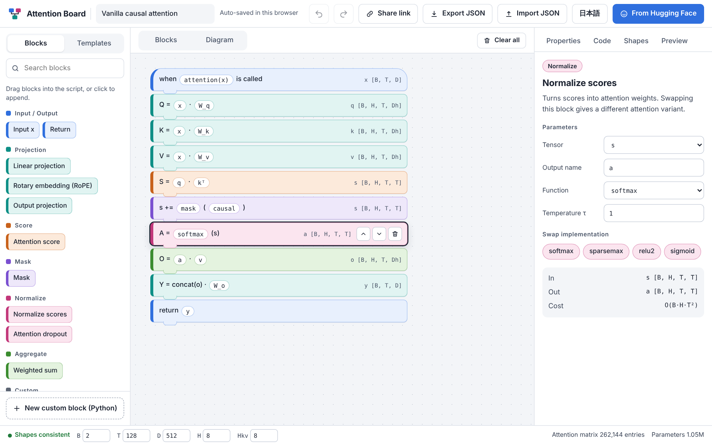
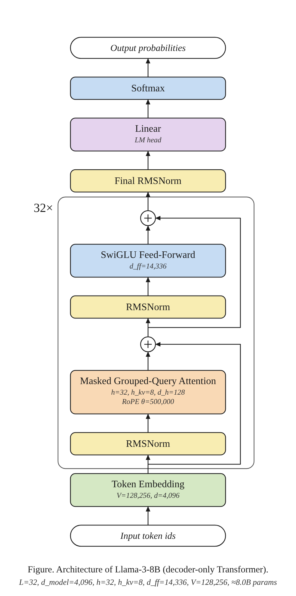
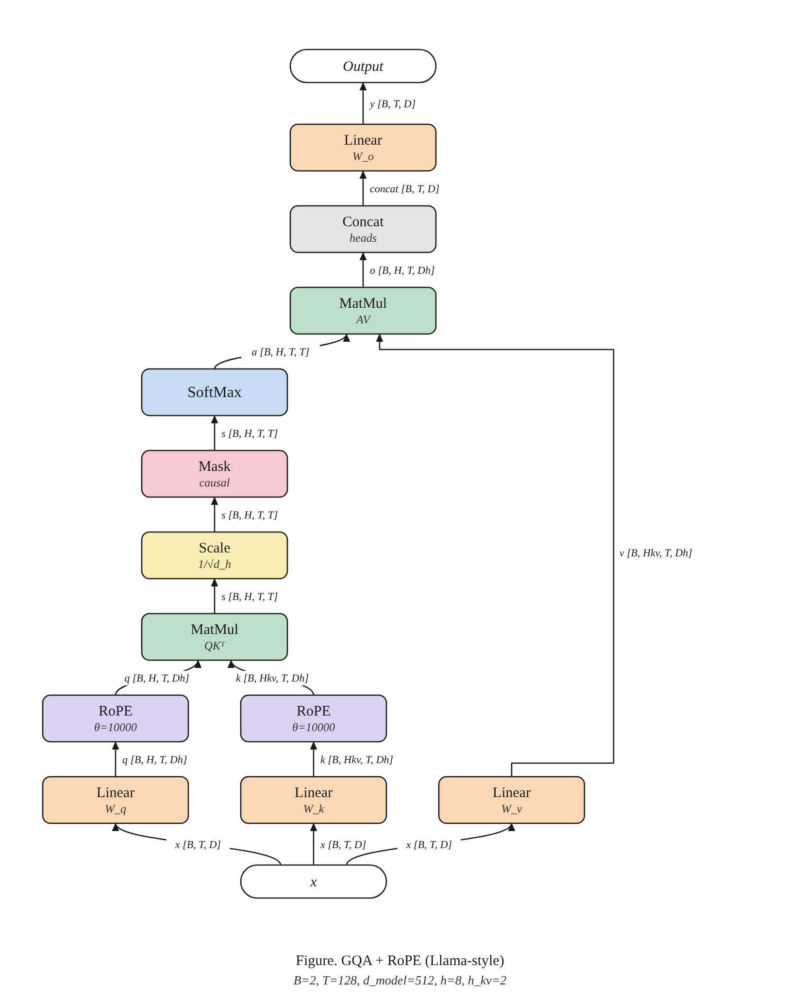

# Attention Board

**Build and test new attention mechanisms by snapping blocks together** — like Scratch, but for research.
Runs entirely in the browser (static site, deployable on GitHub Pages). No build step, no dependencies.

[日本語は下にあります → Japanese below](#日本語)



## What you can do

| | |
|---|---|
| **Block editor** | Drag blocks from the palette into the script (or click to append). Reorder by dragging, `Alt+↑/↓`, or the arrows. Undo/redo with `Ctrl+Z` / `Ctrl+Y`. |
| **Shape checking** | Symbolic shapes (`B, T, D, H, h_kv, d_h`) are inferred block by block. Undefined tensors, wrong ranks and invalid configs are flagged on the offending block. |
| **PyTorch code** | A runnable `nn.Module` is generated live (RoPE, GQA `repeat_kv`, sliding-window / top-k masks, sparsemax … are emitted as helpers). Copy or download the `.py`. |
| **Live preview** | The script is executed in the browser on a scaled-down config with random weights and shown as an attention heat map with entropy / sparsity statistics. |
| **Swap-in variants** | Normalizer: softmax · sparsemax · ReLU² · sigmoid. Score: dot · cosine. Mask: causal · sliding window · top-k. Projection: linear · low-rank, MHA/MQA/GQA, RoPE. |
| **Custom blocks** | Write your own PyTorch statements; declare inputs and the output shape so the checker still follows the data flow. |
| **Paper-style figures** | *Diagram* view draws the attention block as an academic figure (Times, pastel boxes, data flows upward). Export **PNG** (2–4×) or **SVG**. Figure labels are always English. |
| **Hugging Face → architecture figure** | Paste a model URL (`https://huggingface.co/<org>/<model>`); `config.json` is fetched in your browser and drawn as a full-model figure (decoder-only, encoder-only, encoder–decoder, MoE, GQA/MQA/MLA, pre/post-norm, RoPE/ALiBi/learned). One click loads the model's attention layer into the editor. |
| **Share & save** | Auto-saved in `localStorage`; *Share link* encodes the whole program in the URL hash; JSON import/export. |
| **English / 日本語** | UI language switch (remembered). |

| Llama-3-8B (from `config.json`) | Attention block (GQA + RoPE) |
|---|---|
|  |  |

More examples: [`t5-small`](docs/examples/t5-small.png) (encoder–decoder), [`mixtral-8x7b`](docs/examples/mixtral-8x7b.png) (MoE).

## Run locally

```bash
python3 -m http.server 8000      # or: npm run serve
# open http://localhost:8000
```

ES modules need an HTTP server (opening `index.html` via `file://` will not work).

## Deploy on GitHub Pages

Settings → Pages → **Source: GitHub Actions**. `.github/workflows/pages.yml` tests and publishes `index.html`, `css/` and `js/` on every push to `main`.

## Tests

```bash
npm test                                   # unit tests (Node ≥ 20, no dependencies)
pip install playwright && playwright install chromium
python3 -m http.server 8765 &              # browser smoke test (Hugging Face is mocked)
python3 tests/ui_smoke.py
```

## Layout

```
index.html, css/style.css
js/blocks.js     block registry, symbolic shape checker, PyTorch code generator   (pure logic)
js/tensor.js     small numeric evaluator behind the preview                         (pure logic)
js/templates.js  starter programs (vanilla, GQA+RoPE, sliding window, sparsemax, …)
js/hf.js         HF URL parsing, config.json → architecture spec, spec → program
js/diagram.js    SVG figure builders + SVG→PNG export
js/storage.js    program validation, share-link encoding
js/i18n.js       English / Japanese strings
js/app.js, ui.js UI
```

### Adding a block

Add an entry to `BLOCKS` in `js/blocks.js` (`defaults`, `fields`, `parts`, `check`), a `case` in `generateCode`, optionally a case in `js/tensor.js` (preview) and `js/diagram.js` (figure), and the strings in `js/i18n.js`. `npm test` verifies that every block has translations and that all templates pass the checker, generate code and evaluate.

## Notes and limitations

- The preview uses random weights and reduced sizes (`T ≤ 16`, `H ≤ 4`, `d_h = 4`); it shows the *structure* of an attention pattern, not trained behaviour. Custom blocks cannot run in the browser.
- The model figure infers norm placement, FFN type and the positional scheme from `config.json` fields. These heuristics cover common families (Llama/Mistral/Qwen/Gemma/Phi, GPT-2/NeoX, BERT-like, T5/BART, Mixtral/DeepSeek) but can differ from the reference implementation. The parameter count is an estimate.
- Gated/private models: paste `config.json` into the dialog instead.
- Drag & drop uses the HTML5 API (mouse). On touch devices use click-to-append and the arrow buttons.

## License

MIT

---

## 日本語

**ブロックをつなぐだけで、新しいAttentionを設計・検証できるツール**です（Scratchの研究者向け版）。ブラウザだけで動く静的サイトで、GitHub Pagesにそのまま公開できます。

- **ブロック編集**: パレットからドラッグ（またはクリック）で追加、ドラッグ／`Alt+↑↓`で並べ替え、`Ctrl+Z`で元に戻す。
- **Shape検証**: `B, T, D, H, h_kv, d_h` を記号のまま推論し、未定義テンソルやShape不一致を該当ブロックに表示。
- **PyTorchコード生成**: RoPE、GQA、sliding window、top-k、sparsemaxなどを含む `nn.Module` をリアルタイムに生成。
- **プレビュー**: ランダム重み・縮小サイズでブラウザ内実行し、Attentionのヒートマップとエントロピー等を表示。
- **カスタムブロック**: 自作のPyTorchコードを組み込み可能（入力と出力Shapeを宣言）。
- **論文スタイルの構成図**: 「構成図」ビューでAttentionブロックの図を描画し、**PNG（2〜4倍）/ SVG** で書き出し。図のラベルは英語です。
- **Hugging Faceのモデル URL → アーキテクチャ図**: URLを貼るとブラウザが `config.json` を取得し、モデル全体の図を作成（Decoder-only / Encoder-only / Encoder–Decoder、MoE、GQA/MQA/MLA、pre/post-norm、RoPE/ALiBi/学習済み位置埋め込み）。ワンクリックでそのAttention層をエディタに読み込めます。gated/非公開モデルは `config.json` を貼り付けてください。
- **保存と共有**: ブラウザに自動保存、URLに全体を埋め込む共有リンク、JSONの入出力。
- **UI言語**: English / 日本語を切り替え。

起動: `python3 -m http.server 8000` → `http://localhost:8000`（ES modulesのためHTTPサーバーが必要です）。
公開: Settings → Pages → Source を **GitHub Actions** にすると、`main` へのpushで自動デプロイされます。
